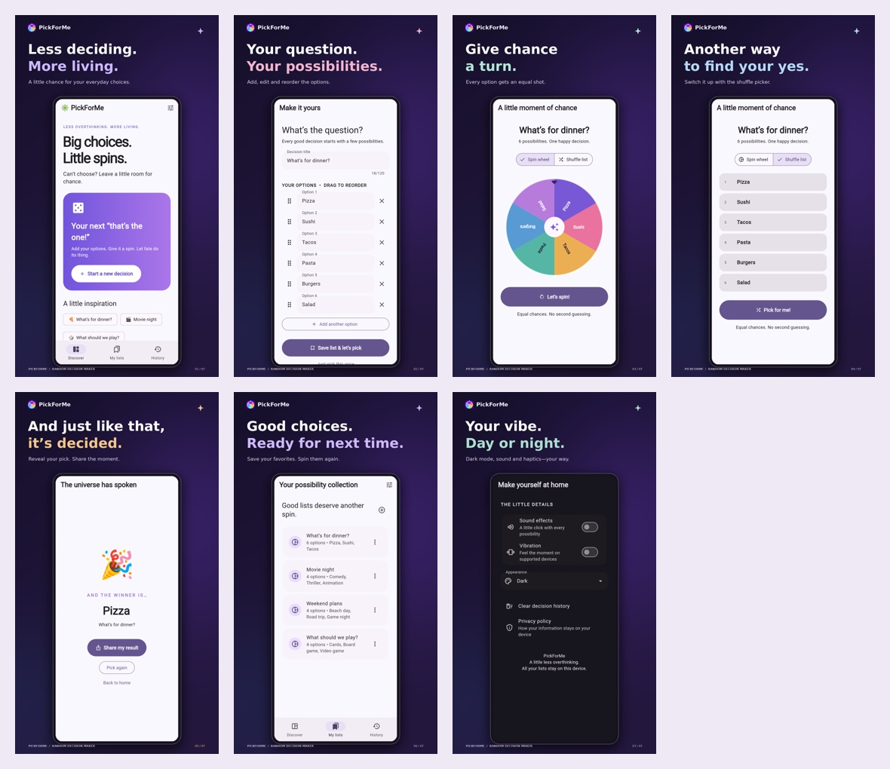

# PickForMe — Store Publishing Kit

Everything for reviewing and preparing the Google Play listing from another device. English (en-US) copy; consistent violet/coral/mint artwork; seven real Flutter screen captures presented in promotional frames.



## Download everything

[Download the complete ZIP](downloads/PickForMe-store-kit.zip?raw=true). On GitHub, open the file and choose **Download raw file** if necessary. Alternatively, use the repository’s **Code → Download ZIP**.

[Open the offline preview gallery](preview.html) after downloading the kit. GitHub shows its source; download/extract the ZIP and open `preview.html` in your browser to see the gallery.

## Files to upload

| Asset | Folder/file |
| --- | --- |
| Play Store icon, 512 × 512 | [branding/app-icon-512.png](branding/app-icon-512.png) |
| High-resolution logo, 1024 × 1024 | [branding/app-icon-1024.png](branding/app-icon-1024.png) |
| Editable vector wordmark | [branding/wordmark-editable.svg](branding/wordmark-editable.svg) |
| Feature graphic, 1024 × 500 | [branding/feature-graphic-1024x500.png](branding/feature-graphic-1024x500.png) |
| Seven phone screenshots, 1080 × 1920 | [screenshots/](screenshots/) |
| Original Flutter captures, 1170 × 2532 | [raw-screenshots/](raw-screenshots/) |
| Copy/paste listing text | [listing/complete-store-listing.md](listing/complete-store-listing.md) |
| Editable listing Word document | [listing/complete-store-listing.docx](listing/complete-store-listing.docx) |
| Listing PDF | [listing/complete-store-listing.pdf](listing/complete-store-listing.pdf) |
| Privacy policy, editable source | [privacy-policy/privacy-policy.md](privacy-policy/privacy-policy.md) |
| Privacy policy Word document | [privacy-policy/privacy-policy.docx](privacy-policy/privacy-policy.docx) |
| Privacy policy PDF | [privacy-policy/privacy-policy.pdf](privacy-policy/privacy-policy.pdf) |
| Policy webpage to host | [privacy-policy/index.html](privacy-policy/index.html) |
| Data Safety and upload guidance | [listing/play-console-guide.md](listing/play-console-guide.md) |

## Publication details

**Public support email:** `zulqarnain.tech9068@gmail.com`.

**Privacy policy:** https://bilalyamin127.github.io/PickForMe/privacy-policy/

The policy is also bundled inside the app under Settings → Privacy policy. Keep the app asset, hosted page and editable documents synchronized after policy changes. Play Console submission and closed-testing rollout are tracked separately; asset preparation does not itself submit the app.

## Screenshot order

1. Home — everyday decisions.
2. Create — titles, choices and reordering.
3. Wheel — colorful equal segments and spin action.
4. Shuffle — a second picker mode.
5. Result — selected choice and native sharing action.
6. Saved lists — reusable decisions.
7. Settings — dark appearance and feedback preferences.

Captures use the real Flutter widgets at a 390 × 844 logical viewport, 3× pixel density, with illustrative lists/results and a fixed sample timestamp. Rendering fonts are explicitly loaded for capture because Flutter’s test runner otherwise substitutes its block-shaped test font. The UI content is not painted over or fabricated. Outer frames and editorial captions are promotional layout. Raw captures are included for inspection. They are not Android-device installation screenshots; check the final signed build on a real phone before submission.

## Editable sources and regeneration

`source/` includes the original generated logo master, artwork compositor, capture fixture, capture helper and document generator. The production logo master is raster; the supplied SVG wordmark is editable vector artwork. Brand icon exports also replace the default Android/iOS/web launcher icons in the Flutter project.

On Linux with Flutter and Python:

```sh
python3 -m pip install -r store/source/requirements.txt
python3 store/source/capture_screenshots.py --flutter /path/to/flutter/bin/flutter
python3 store/source/build_documents.py
python3 store/source/render_assets.py
# Optional: apply changed logo to the app launcher assets
python3 store/source/update_launcher_icons.py
python3 store/source/package_kit.py
```

Font notes: screenshot capture uses the Roboto and MaterialIcons fonts bundled with your Flutter SDK. Noto Color Emoji is used when available; the helper accepts an emoji font path. Artwork composition uses DejaVu Sans on Linux, with an override through `PICKFORME_FONT_DIR`. Use the same fonts for consistent text metrics. No third-party brand marks or device logos appear in the artwork.
